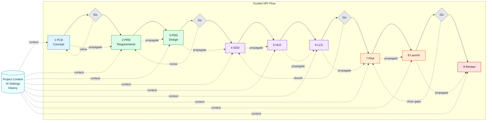

# NPI Document Builder (Standalone)

AI-assisted standalone tool for building the core New Product Introduction (NPI) artifacts:

- PCD (Product Concept Document)
- PRD (Product Requirements Document)
- PDD (Product Design Document)
- SDD / HLD / LLD (Technical design docs)
- Risk Register
- Launch Checklist
- Post-Launch Review

## Polish Pass Completed (todo item 2)
- **Slick minimalist PDF export** (primary polished output) + matching improved DOCX style — clean, reusable design for any project.
- **Stronger propagation**: "Propagate to next" builds rich context from all upstream documents and drafts the target.
- **Wizard-style full-screen mode** (big focused stepper + editor, triggered by "Wizard" or ⌘K).
- **Keyboard shortcuts**: ⌘S checkpoint, ⌘→/← next/prev doc, / focus ProdBot, ⌘K wizard, ⌘⇧F bulk fill.
- **Permanent "ProdBot"** Smart Assistant (always-visible chat + quick actions like propagate, consistency, "what next?").
- **Better bulk AI operations**: Fill empties, Regenerate whole document, Cross-document Consistency Review.
- **Versioned history**: Manual "Checkpoint" + auto-snapshots after bulk work. Restore previous states from the History panel.
- **Nicer editing experience**: Per-field Markdown toolbar (**bold**, *italic*, lists, code, quote) + live Preview toggle that renders formatted content.
- General UX: cleaner bulk buttons, loading states, history integration, better persistence for older projects.

## Quick start (web / dev version - works today)

```powershell
cd document-builder
npm install          # if not already
npm run dev
```

Open http://localhost:5173

- Fill the global **Project Context** (highly recommended — it travels with every AI call).
- Click any document on the left.
- Edit fields directly or use the **AI Generate / Refine / Critique** buttons per section.
- Use "AI: Fill empty sections" for a document.
- Configure your LLM in **AI Settings** (top right or gear):
  - xAI Grok: `https://api.x.ai/v1` + model `grok-3-latest` (or current)
  - OpenAI: `https://api.openai.com/v1`
  - Local (Ollama): `http://localhost:11434/v1` after `ollama run llama3.1` etc.
- Exports: per-document .md / .docx, full project .zip (contains all .md + metadata), or "Save files to folder" (Chromium File System Access — writes real files you can git, zip, share).

By default the app does not retain project content between sessions and does not allow AI uploads until you explicitly enable those options in Privacy Controls.

## Privacy Defaults

- Local project retention is off by default. Enable it explicitly if you want recovery across sessions on the current device.
- AI transfers are off by default. NPI content is only sent to the configured provider after you opt in.
- Browser builds keep AI keys only in memory for the current session.
- Electron builds store AI keys in OS-backed secure storage via Electron's secure APIs.
- Example SmartOps seed data is available in development, but it is stripped from production builds.

## Portable desktop app (Electron)

The project is already set up for true standalone portable apps.

```powershell
# One-time: build the web assets + package
npm run dist:win          # tries to produce a portable .exe (may hit Windows AV/perm issues)
npm run dist:win-dir      # produces dist\win-unpacked — zip this folder and run the .exe inside from anywhere (highly portable, no install)

# Or for Linux (from WSL or Linux box)
npm run dist:linux
```

**GitHub Actions builds (recommended when local packaging is flaky)**

You can get a clean Windows portable build without fighting Defender/OneDrive/long paths on your machine:

1. Push your code (or just use the web UI).
2. Go to the **Actions** tab → **Build & Package** workflow.
3. Click **Run workflow** (or push a tag like `v0.1.0` once you start versioning).
4. Download the `NPI-Builder-Windows-Portable` artifact when it finishes.

This runs on GitHub's clean `windows-latest` runner and uses the same `npm run dist:win` script. No code signing is configured yet (you will see a SmartScreen warning — click through or right-click → Properties → Unblock).

**Known packaging note on this Windows machine**: `electron-builder` sometimes hits `EPERM` during internal Electron extraction (rename of temp dir). This is environmental (Defender, OneDrive, D: drive permissions, long paths). Workarounds that usually succeed:

1. Move the `document-builder` folder to `C:\tmp\npi-builder` (short path, no cloud sync).
2. Temporarily disable real-time protection or add an exclusion for the folder.
3. Run PowerShell as Administrator for the `dist:*` command.
4. Use `npm run dist:win-dir` (the unpacked dir is often more tolerant).
5. After a successful unpack you can reuse the `dist\win-unpacked` or copy the produced portable exe.

Once packaged you get a real no-install executable (or AppImage on Linux) that feels like a native app, has its own window, and can be distributed on USB drives, shared drives, etc.

## Why this approach has high efficacy

- The functional core (structured templates + excellent AI prompts + exports + context) was built extremely quickly on the same data model as the main NPI Guide.
- Web tech (Vite + React + TS) = fast iteration, great DX, one codebase.
- Electron gives cross-platform (Win + Linux) desktop with minimal extra code.
- Future: the exact same frontend can be repackaged with Tauri (much smaller ~10-30 MB binaries, better security) once Rust is available on the machine.
- Projects are just data + markdown files → extremely portable and version-control friendly.
- AI is provider-agnostic (bring your own key or local model) — no vendor lock and works offline-ish with local LLMs.

## Next (after this foundation)

- Add "consistency check across docs" AI action (global).
- Versioned snapshots inside a project.
- Apply the exact same portable packaging pattern to the main Interactive NPI Guide and other modules of the Product Developer project.

Run `npm run dev` inside this folder to start using the document builder right now.

## Workflow Diagram

Two high-quality assets were created to communicate the NPI Builder flow:

- **[NPI-Builder-Workflow.html](NPI-Builder-Workflow.html)** — Fully interactive, self-contained dark-themed diagram (open directly in any browser). Click any stage for details. Matches the app's deep navy + electric cyan + retrowave violet aesthetic.
- **NPI-Builder-Workflow.png** — Polished static 16:9 version ideal for READMEs, decks, Notion, marketing, or documentation.

Both reflect the canonical 9-stage guided flow with emphasis on strong context propagation.

## Mermaid Workflow (Copy/Paste Ready)

Use this in Markdown environments that support Mermaid rendering:



Source file: `NPI-Builder-Workflow.mmd`.
