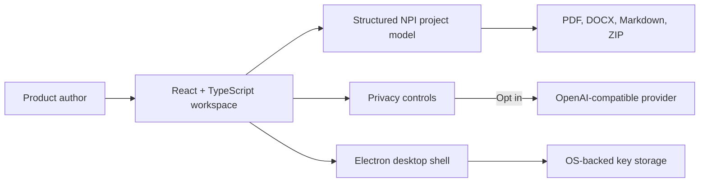

# NPI Builder v0.1.0

NPI Builder is a local-first workspace for turning product intent into a coherent set of New Product Introduction artifacts. It guides a product team from concept through requirements, design, technical planning, risk, launch readiness, and post-launch review without forcing project content through a hosted application.

## Why NPI Builder exists

Product work often starts in many places: notes, spreadsheets, tickets, chat threads, and one-off documents. The result is an NPI package that is slow to assemble, difficult to keep consistent, and hard to review as a connected whole.

NPI Builder was built to make that process deliberate and repeatable. It provides a structured path through the core artifacts, preserves context as work moves downstream, and keeps the author in control of what stays on the device and what is sent to an AI provider.

## What is included

- A guided workflow for PCD, PRD, PDD, SDD, HLD, LLD, Risk Register, Launch Checklist, and Post-Launch Review.
- Structured fields and document guidance that make each artifact easier to complete and review.
- Context propagation, document refinement, consistency review, checkpoints, recovery, and the ProdBot workflow assistant.
- Export to PDF, DOCX, Markdown, and a portable project ZIP.
- Optional AI assistance through OpenAI-compatible providers, including OpenAI, xAI, GitHub Copilot, Ollama, and custom endpoints.
- A portable Windows desktop application alongside the browser-based development build.

## Architecture

NPI Builder separates the authoring experience, document model, AI integration, and desktop security boundary:

- **React, TypeScript, and Vite** deliver the interactive authoring workspace.
- **A structured local project model** holds project context, artifact sections, metadata, and checkpoint history.
- **Optional direct-to-provider AI requests** keep provider choice with the author. Remote providers require HTTPS; local loopback providers such as Ollama can use HTTP.
- **Electron** packages the same workspace as a desktop application. The renderer is sandboxed and isolated, navigation and popups are blocked, and desktop key storage is exposed only through a restricted preload bridge.
- **Client-side export libraries** produce documents locally. There is no application backend and no hosted project database.

## Privacy and security

AI transfers and local project retention are disabled by default. Enable them only when needed. Browser keys remain in memory unless the author explicitly chooses browser persistence. Desktop builds use OS-backed secure storage when a supported key store is available.

Project files and exports are not encrypted. Review them before sharing. Desktop builds are currently unsigned, so verify the published SHA-256 checksum before running a download.

The release pipeline runs dependency auditing, AI and security tests, production browser tests, and package-content verification. The published source is licensed under the MIT License.

## Known limitations

- AI providers must support an OpenAI-compatible chat-completions API; browser builds also require CORS support.
- The current release includes a Windows x64 portable build. Linux packaging is supported from a Linux build environment.
- NPI Builder does not replace product, security, legal, or engineering review. It helps teams create and maintain the materials those reviews require.

## Verification

This release passed the dependency audit, AI/security tests, production browser tests, Electron desktop smoke test, and packaged-archive inspection.

